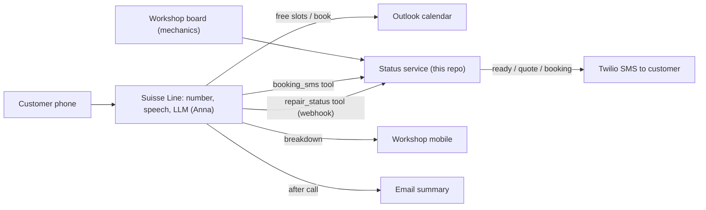

# Garage Meier: Suisse Line phone assistant (Challenge A)

Anna answers the phone for Garage Meier, a fictional car repair workshop in Zurich. She books appointments in the workshop's Outlook calendar, answers questions from the knowledge base, sends urgent breakdowns to a person, and emails a summary after every call.

**Extra feature: "Is my car ready?"** Status calls are among the most common calls a workshop gets, and they interrupt mechanics. Mechanics update each car on a simple workshop board (status, expected ready time, quote, note). When a customer calls, Anna asks for the licence plate, calls the `repair_status` tool, and reads back the live status. If the caller doesn't know the plate, the tool matches their phone number. If a quote is waiting, Anna gives the amount and takes the customer's answer as a message; she never approves work herself.

**SMS updates.** When a mechanic sets a car to "ready" or "waiting for approval" on the board, the customer gets an SMS automatically (once per status change). After Anna books an appointment, she calls `booking_sms` and the customer gets a confirmation text. SMS goes through Twilio; without Twilio credentials the service runs in test mode and saves each text to `server/data/sms-outbox/` instead of sending it.

## Architecture



| Part | Where it lives |
|---|---|
| Phone number, speech, LLM, call logs | Suisse Line (`app.suisse-line.ch`) |
| Prompt | `assistant/prompt.md`, pasted into Configuration > Instructions |
| Shop facts, prices, hours | `assistant/knowledge.md`, uploaded to Knowledge Base |
| Appointments | Microsoft Outlook calendar via Integrations |
| Repair status tool + workshop board | `server/` (Node 20+, no dependencies) |

## Run the status service

```powershell
node --env-file=.env server/server.js   # board on http://localhost:8787 (any username, password BOARD_PASSWORD)
npm run tunnel                          # temporary public URL for Suisse Line
npm test                                # 15 tests
```

`.env` holds `TOOL_TOKEN` and `BOARD_PASSWORD` (not committed). To send real SMS, add `TWILIO_ACCOUNT_SID`, `TWILIO_AUTH_TOKEN` and `TWILIO_FROM` (your Twilio number) to `.env` and restart. A Twilio trial account only texts numbers you have verified in Twilio, which is enough for a demo to your own phone. Every webhook call from Suisse Line is saved to `server/data/webhook-log/` so you can see the exact payload.

The tunnel URL changes on every start, so the tool's Webhook URL must be updated each time.

**Deploy (GitHub + Render).** Repo: https://github.com/koryun2/suisse-line-garage (private). `render.yaml` defines a free Node web service in Frankfurt. After the first deploy, set `TOOL_TOKEN` and `BOARD_PASSWORD` in the Render dashboard to the same values as local `.env`, then point Suisse Line tools at:

- `https://<service>.onrender.com/tools/repair-status?token=<TOOL_TOKEN>`
- `https://<service>.onrender.com/tools/booking-sms?token=<TOOL_TOKEN>`

Free instances sleep after idle time and have no persistent disk, so demo cars reload from `seed-jobs.json` on a cold start. Twilio keys stay optional.

## Suisse Line settings

**Configuration**
- Greeting: `Hello, this is Anna from Garage Meier. How can I help you?`
- Start language: English. Voice: Anna.
- Instructions: contents of `assistant/prompt.md`.

**Tools > Add tool**
- Tool Name: `repair_status`
- HTTP Method: `POST`
- When to Use: `Use when the caller asks about a car that is already at the workshop: whether it is ready, the repair status, when they can pick it up, or a quote. Pass the licence plate if the caller gives it. Read the "message" field of the result back to the caller in your own words.`
- Webhook URL: `<tunnel URL>/tools/repair-status?token=<TOOL_TOKEN>`
- Parameter: `license_plate` (string, optional), "Swiss licence plate as said by the caller, e.g. ZH 123456"
- Execution behaviour: leave all three toggles off.

**Tools > Add tool (second tool)**
- Tool Name: `booking_sms`
- HTTP Method: `POST`
- When to Use: `Use right after an appointment has been booked in the calendar, to send the caller an SMS confirmation. Pass the caller's mobile number, the service, the booked date and time in words, the car and the licence plate.`
- Webhook URL: `<tunnel URL>/tools/booking-sms?token=<TOOL_TOKEN>`
- Parameters (all strings): `customer_phone` (caller's mobile number), `service` (booked job, e.g. Small service), `date_time` (e.g. Wednesday 11 November at 14:30), `car` (make and model), `license_plate`
- Execution behaviour: turn on "Don't wait for result".

**Opening Hours**: Mon to Fri 07:30 to 12:00 and 13:15 to 18:00; Sat 08:00 to 12:00; Sun closed.

**Knowledge Base > Add Content**: upload `assistant/knowledge.md` (or the `.txt` copy).

**Integrations**: Connect with Microsoft (Outlook.com or Microsoft 365).

**Call Forwarding > Forward to a phone number**: your mobile, condition "breakdown, accident or safety problem".

**Emailing**: enable email summaries for conversations.

**Advanced**: time zone Zurich (already set).

## Test plan

Use Chat test first (it costs no minutes), then Test call, then one call from a real phone.

| # | Caller says | Expected |
|---|---|---|
| 1 | "I need a small service for my Golf next week." | Asks plate, name, phone; offers up to 3 free slots in hours; books 60 min; reads time back |
| 2 | Asks for Sunday 10:00 | Refuses (closed), offers Monday |
| 3 | Picks a slot that is already busy in Outlook | Does not double-book; offers another slot |
| 4 | "Is my car ready? Plate ZH 123456" | Tool: in repair, ready Wed 11 Nov 16:00, brake pads note |
| 5 | "What about AG 45789?" | Tool: waiting for approval, quote CHF 860; takes yes/no as a message |
| 6 | Calls from +41 78 777 88 99 without a plate | Tool matches phone: Toyota Yaris is ready for pickup |
| 7 | Plate BE 000 | Asks to repeat once, then takes a callback message, invents nothing |
| 8 | Change status on the board to "ready", ask again | Anna now says ready |
| 9 | "My car won't start on the motorway" | Asks if safe, takes location and plate, forwards the call, no booking |
| 10 | "How much is a tyre change?" | CHF 80 (wheels on rims) or CHF 140; no invented prices |
| 11 | Speaks German halfway through | Switches to German and stays |
| 12 | Stop the status service, ask for status | Says she can't check right now, takes a message |
| 13 | Book an appointment (needs the calendar) | After booking, `booking_sms` fires; text in `sms-outbox` or on your phone |
| 14 | Set a car with a phone number to "ready" on the board | One SMS; editing the note afterwards sends no second SMS |
| 15 | Set AG 45789 to "waiting approval" again | SMS with the CHF 860 quote |

After each call, check Call Logs (transcript), the Outlook calendar, the summary email and `server/data/webhook-log/`.
